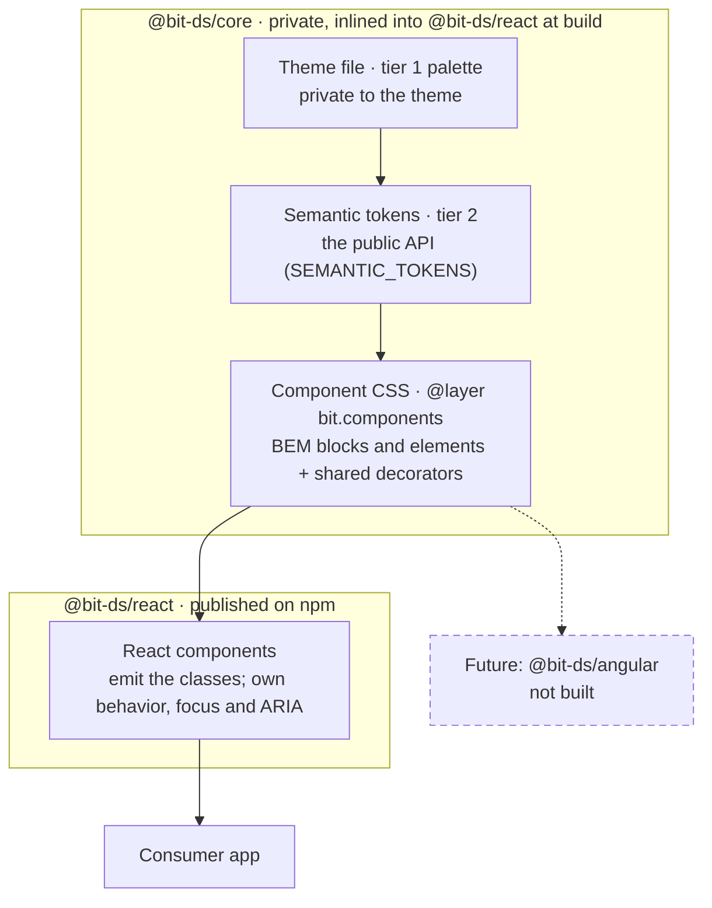
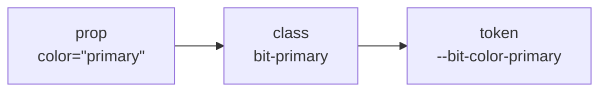

# bit architecture

This file is the current design of bit. Keep it in step with the code: when a decision changes, change it here in the same pull request. The dated specs and plans in `docs/superpowers/` record how bit got here (see [Decision history](#8-decision-history)). Where they disagree with this file, this file and the code win.

## Contents

1. [What bit is](#1-what-bit-is)
2. [System at a glance](#2-system-at-a-glance)
3. [The naming rule](#3-the-naming-rule)
4. [What kind of design system this is](#4-what-kind-of-design-system-this-is)
5. [Accessibility architecture](#5-accessibility-architecture)
6. [Quality gates](#6-quality-gates)
7. [Known gaps and next decisions](#7-known-gaps-and-next-decisions)
8. [Decision history](#8-decision-history)

## 1. What bit is

bit is a React component library and design system built on a CSS core that doesn't depend on any framework. The core holds the design tokens (named values such as `--bit-color-primary`) and the CSS for every component. `@bit-ds/react` renders the classes that CSS styles and adds the behavior: keyboard, focus and ARIA. A theme changes only token values, so every component stays the same in every theme. bit has 33 components, one theme (power-up) in light and dark mode, and no runtime dependencies. React 19 is a peer dependency.

## 2. System at a glance

Data flows top to bottom. Each box is one layer; the outer boxes are package boundaries.



- **Theme file** (`packages/core/src/themes/power-up.css`). Tier 1 is the raw palette (`--bit-palette-violet`), and only the theme file reads it. Tier 2 maps the palette onto roles (`--bit-color-primary: var(--bit-palette-violet)`). A dark block overrides exactly the tokens listed in `MODE_TOKENS`.
- **Semantic tokens** (`packages/core/src/tokens.ts`). `SEMANTIC_TOKENS` lists every public token name. A completeness test fails any theme that leaves one out.
- **Component CSS** (`packages/core/src/components/*.css`). This CSS reads only tier-2 tokens and bit's private variables, never the palette. A system test fails if a component file isn't imported into `index.css` in the `bit.components` layer.
- **`@bit-ds/react`** (`packages/react/src/`). It renders `bit-*` classes through one helper, `toClasses`, and owns everything CSS can't do: focus management, keyboard models, ARIA wiring and form behavior. Its build (tsup) inlines `@bit-ds/core`, so the published package's types and CSS stand alone.
- **Future: `@bit-ds/angular`.** Not built. The core keeps all styling out of React so that a second framework would need only its own behavior layer. bit is designed for a second framework; it doesn't support one today.

The CSS ships in three cascade layers. A cascade layer is a named group of styles, and styles outside any layer always win over styles inside one:

```css
@layer bit.reset, bit.tokens, bit.components;
```

`styles.css`, every theme and `icons.css` declare this order at the top, so it holds whichever file loads first.

## 3. The naming rule

The word you type as a prop is the word in the class and the word in the token. Grep for any one of them and you find the other two.



The class in the middle is a **decorator**: one `bit-{value}` class that means the same thing on every component. Color decorators are written once, globally, in `packages/core/src/system/colors.css`. Each one sets private variables (prefixed `--_bit-`, never public API) from the public tokens:

```css
.bit-primary {
  --_bit-color: var(--bit-color-primary);
  --_bit-color-contrast: var(--bit-color-primary-contrast);
  --_bit-color-hover: var(--bit-color-primary-hover);
  --_bit-color-soft: var(--bit-color-primary-soft);
  /* … edge and outline-shadow */
}
```

Every component reads `--_bit-color` and its siblings. It never reads `--bit-color-primary` directly. So adding a color to the whole system is four tokens per theme plus one rule in `colors.css` (CONTRIBUTING, "Add a color to the whole system"). No component file changes. Sizes work the same way through `system/sizes.css`. Variants (`solid`, `outline`, `ghost`) are per component, because an outline Card and an outline Button draw differently.

The same classes work without React. `<Card><CardHeader>` and `<div class="bit-card bit-solid"><div class="bit-card__header">` render the same thing. For interactive components, the classes give only the look, and the behavior comes from React. The README's [naming rule](README.md#the-naming-rule) has the full table.

## 4. What kind of design system this is

Six choices define bit's kind. Each row says what we chose, what we turned down, why, what it costs us, and what would make us look again.

| Axis | bit's choice | Rejected alternatives | Why | Cost we accept | Revisit when |
| --- | --- | --- | --- | --- | --- |
| **Implementation model** | A shared CSS core plus one implementation per framework (React today) | Web Components; React and Angular at once; CSS only | "Fastest path to a good v1" (spec §12, Frameworks). CSS alone can't enforce keyboard behavior or ARIA. Web Components would put ARIA ID references (`aria-labelledby`, `aria-controls`) behind shadow roots they can't cross, and theming and SSR need extra work across Shadow DOM. | Every framework needs its own behavior layer, written and tested again. | A second framework is actually needed. |
| **Distribution** | One published package, `@bit-ds/react`, with the core inlined; no runtime dependencies; React 19 as a peer | Per-component packages; copy-in source (shadcn style) | One maintainer gets one version to reason about. Copied-in source doesn't receive fixes. Zero dependencies since 0.1.3 (commit `f3fd5eb`), checked by `verify-dist.mjs`. | Consumers can't pin one component's version; they take the whole package. | A second framework package needs `@bit-ds/core` published on its own. |
| **Tokens** | Three tiers as runtime CSS custom properties, written by hand, with no token build pipeline | Style Dictionary (JSON source to many outputs) | There is one output target: CSS. A completeness test, a per-mode contrast test and a frozen-value test (`px-rename.test.ts`) guard the hand-written file. | No JSON source of truth; tokens can't be exported to other platforms. | A second platform target exists: a Tailwind preset, native apps, or a Figma variables sync. |
| **Styling** | Plain CSS in cascade layers; BEM-style blocks and elements; shared decorators instead of BEM modifiers | Runtime CSS-in-JS; utility-first classes; Shadow DOM | Plain CSS has no runtime cost and works with React Server Components. Utility-first would make the consumer's markup the API. Layers let any unlayered consumer style win without `!important` (CHANGELOG 0.1.9). | Selectors need discipline that a scoped style system would enforce for us. bit's guard tests do that job instead. | A consumer needs style isolation that layers can't give. |
| **Component API** | Configuration through three shared axes (`color`, `variant`, `size`), plus composition through compound parts and `asChild` | Per-component prop vocabularies; render props | One vocabulary at every layer is the naming rule (spec §2). Union types catch a wrong value at compile time. At run time, an unknown value is dropped with a dev-only warning, and nothing throws. | Some components can't take every axis value, and plain-JS callers get a warning, not an error. | A component needs an option that doesn't fit an axis. Then it gets its own prop, as `Slider`'s `variant` did. |
| **Governance** | Centralized, with one maintainer. The contribution recipes in CONTRIBUTING (add a component, a color, a theme, an icon) are checked by CI, not only by review. | Federated contributions from product teams | bit has one maintainer. The recipes fail loudly when a step is missed: theme completeness, the class contract, the manifest contract, `expected-exports.mjs`, the icon drift test. | Throughput is one person. | A second team contributes components. |

Four rules sit under the component API row:

- **Booleans are attributes, never classes.** They use native attributes where they exist (`disabled`, `aria-invalid`) and `data-*` otherwise (`data-loading`). Two shipped classes break this rule, `bit-flat` and `bit-iconFilled`, and stay until 0.2.0 revisits them (CONTRIBUTING, "Conventions").
- **`className` is appended last.** A decorator in it replaces the prop's decorator for that axis, so `<Button className="bit-danger">` is a danger button.
- **Compound parts are separate exports** (`Card`, `CardHeader`), and each maps to a BEM element class (`bit-card__header`).
- **`asChild`** puts a component's classes and behavior on your own element. It uses bit's internal `createSlot`, which keeps Radix Slot's rules and is pinned by tests (`packages/react/src/system/Slot.tsx`).

### Tokens, tier by tier

- **Tier 1, palette.** Private to each theme file.
- **Tier 2, semantic.** The public API: colors, shape, type, space, controls, motion, focus ring and code. Space, radius and text tokens are named by their value (`--bit-space-16px`). That rename (D13) changed no rendered size, and a frozen table proves it. `TODO(owner): confirm rationale` for value names over ordinal names.
- **Tier 3, component tokens.** There's no separate tier. When one component needs a knob the others don't, it becomes a named tier-2 role that every theme must declare, such as `--bit-color-knob` (the Switch thumb), `--bit-color-stripe` (Table stripes) and the `--bit-code-*` set.

### Interactive behavior

Interactive components are built on native elements where one fits: Dialog on `<dialog>` and `showModal()`, Slider on `<input type="range">`, and Checkbox, RadioGroup, Switch and SegmentedControl on native inputs. Where no native element fits, bit follows a WAI-ARIA pattern: Select is a select-only combobox, Menu a menu button, plus Tabs and Tooltip. Nothing uses Radix Primitives. This reverses the v1 plan (spec §12, "Interactive a11y"). `TODO(owner): confirm rationale` for building every interactive component without Radix. What's on record: the last Radix package left in 0.1.3, giving zero runtime dependencies. Select's own list exists because the owner wanted it to look the same in every browser (`specs/2026-10-07-select-dropdown-design.md`).

## 5. Accessibility architecture

- **Native first.** A native element brings its keyboard, form and screen-reader behavior for free, so bit uses one wherever it fits (see [Interactive behavior](#interactive-behavior)).
- **WAI-ARIA patterns only where needed:** combobox (Select), menu button (Menu), tabs (Tabs) and tooltip (Tooltip). Each pattern's keyboard model is tested key by key in unit tests.
- **One focus ring.** `packages/core/src/system/reset.css` draws the only focus ring, from the `--bit-focus-ring-*` tokens. Component CSS never sets `outline` or its longhands, and `system.test.ts` enforces that.
- **Contrast is computed, not eyeballed.** `contrast.test.ts` reads the theme tokens and computes WCAG ratios in light and dark. A color change that drops text below 4.5:1 fails CI.
- **Forced colors** (Windows High Contrast). Component CSS has `forced-colors` rules, and Playwright checks that states such as invalid still show without color.
- **Reduced motion.** Each component stops its own animation under `prefers-reduced-motion: reduce`. bit doesn't touch motion outside its components. `reduced-motion.test.ts` checks this.

The gallery's [Accessibility page](https://doosemavis.github.io/bit-design-system/#/accessibility) shows each of these live.

## 6. Quality gates

Every pull request runs `.github/workflows/ci.yml`:

- **Build and verify.** It builds `@bit-ds/react`, then `verify-dist.mjs` checks the exports, the types, and that there are no runtime dependencies.
- **Typecheck and lint.** The lint config bans raw HTML tags (`<button>`, `<table>`, `<h1>`…) in the gallery, so the docs can only use bit components.
- **Core tests.** These cover theme completeness, contrast in both modes, the frozen token values, the cascade layers, fonts, forced colors and reduced motion.
- **React tests with coverage.** CI fails under 80% (`packages/react/vitest.config.ts`). At `6e9a745`, coverage is 100% of lines and functions, 99.85% of statements and 99.42% of branches. axe-core runs on what every component renders.
- **Gallery tests.** Every route renders and passes axe, every component export has a manifest, and `gallery.css` stays layout only.
- **Script tests** (`scripts/*.test.mjs`). They check the workflow security rules, the supply-chain settings and the release steps.
- **Smoke test.** CI packs the tarball, installs it into a fresh TypeScript project, type-checks it and imports it as both ESM and CommonJS.
- **End to end.** Playwright runs axe on every docs page in light and dark against WCAG 2.0, 2.1 and 2.2 A and AA, plus forced-colors runs and page flows.

A release starts from a `v*` tag on `main` and runs `.github/workflows/release.yml`:

1. **guard** checks that the tag matches the package version and that the commit is on `main`.
2. **build** packs the tarball, smoke-tests it in a fresh project and in Chromium, and records its sha256 and npm integrity.
3. **publish** waits for a reviewer's approval. It refuses a tarball whose sha256 changed, then publishes with provenance (a signed record of which workflow built the package). It holds the only credential and installs nothing.
4. **verify-install** waits for npm to show the version, compares npm's integrity with the built tarball, and installs it.
5. **github-release** and **deploy** publish the release notes and the versioned docs site.

Pull requests rehearse the release as a dry run. Docs-only changes deploy from `main` while `packages/` is unchanged since the last tag (CONTRIBUTING, "Docs site").

## 7. Known gaps and next decisions

- **No visual-regression suite.** Visual changes are reviewed with light and dark screenshots before they merge.
- **Angular is designed for, not built.** The core is framework-agnostic, but no second framework has proved it yet.
- **No token build pipeline.** Tokens exist only as CSS. A second platform target would bring Style Dictionary or something like it back into question.
- **`@bit-ds/core` isn't published.** It's inlined into `@bit-ds/react`. A second framework package would need it published on its own.
- **Three classes break the naming rules** (`bit-iconButton`, `bit-iconFilled`, `bit-flat`). They stay until 0.2.0 revisits them.
- **The release still uses an npm token.** Trusted publishing must replace it before January 2027 (CONTRIBUTING).
- **Open rationale.** Each of these needs a recorded reason:
  - `TODO(owner): confirm rationale` for building interactive components without Radix Primitives.
  - `TODO(owner): confirm rationale` for value-named scale tokens over ordinal names.
  - `TODO(owner): confirm rationale` for a hand-run, tag-triggered release over Changesets.

## 8. Decision history

The files in [`docs/superpowers/`](docs/superpowers/) are historical records. Each is dated, and each says what was planned at that moment. They aren't rewritten to match today; a dated _Superseded_ note marks each place where the build moved away from them.

- **[Base design spec](docs/superpowers/specs/2026-09-06-bit-design-system-design.md)** (2026-09-06). The v1 plan, with its decisions log (§12) carried forward to 0.1.9.
- **[Gallery and color-axis addendum](docs/superpowers/specs/2026-09-12-gallery-and-color-axis-addendum.md)** (2026-09-12). The rename from `tone` to `color`, the packaging fix, and the gallery replacing Storybook.
- **[Specs](docs/superpowers/specs/)**. One per feature: dark mode, foundations, the release pipeline, Select, Dialog and Tabs, icons, and more.
- **[Plans](docs/superpowers/plans/)**. The task-by-task build plans, including the engineering-review decision IDs (D1 to D16) in `2026-09-13-gallery.md`.
- **[CHANGELOG](CHANGELOG.md)**. Every package release, one change per line.
